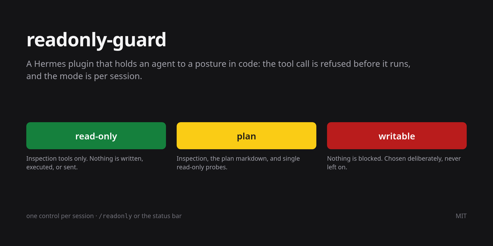

# hermes-readonly-guard



A Hermes plugin that holds an agent to a posture **in code**, not in a prompt. While
`readonly` or `plan` is active, every tool call that is not on a small inspection
allowlist — or a single, allowlisted, read-only command — is refused before it runs, and
the refusal happens in `pre_tool_call`, ahead of the approval layer — so `--yolo` and `approvals.mode: off` do not lift it.

The mode is **per session**. Turning the guard off to do one edit cannot turn it off under
another chat that is already running, which is the failure a machine-wide switch
guarantees eventually.

Published as **`hermes-readonly-guard`**; it installs and registers as **`readonly-guard`**.

## Why

- **A prompt is a request.** A model that ignores instructions, or a session started with
  `--yolo`, still cannot call `write_file` in `readonly`: the hook vetos the call.
- **One switch per session.** Each session has its own entry in one small table, so
  loosening one chat leaves the others exactly where they were.
- **Plan mode is enforced, not suggested.** `/plan` alone is a prompt; in `plan` mode this
  plugin also blocks the writes and commands that would contradict it.

## Install

From the catalog, once it is listed:

```bash
hermes plugins install readonly-guard
hermes plugins enable readonly-guard --no-allow-tool-override
```

From this repository, before that:

```bash
hermes plugins install mciocchi/hermes-readonly-guard
hermes plugins enable readonly-guard --no-allow-tool-override
```

`--no-allow-tool-override` is the right flag for a hook-only plugin: this one replaces no
built-in tool, it only vetoes calls.

Then start a **new session** — a running session does not pick up a newly enabled plugin.
New sessions start at `readonly`.

For the status-bar control (Desktop): Sidebar → **Capabilities → Plugins**, turn on
*Read-only guard*, then **Rescan**, which copies `desktop/plugin.js` out of the package.

Requirements: Hermes with plugin manifests at schema 2, Python 3.11 or newer, and no
extra packages — the plugin imports only the standard library and Hermes itself. It makes
no network calls and defines no environment variables.

Platforms: Linux, macOS, and Windows, with the test suite running on all three. On Windows,
Hermes executes `terminal` through Git Bash, so read-only probes are the same coreutils
commands (`ls`, `cat`, `grep`, `find`, `git`). `file`, `tree`, `column`, `jq`, and `rg` are
not part of Git Bash, so those probes answer "command not found" until you install them.

## The three modes

| Mode       | Inspection tools | Single read-only probes | Plan markdown | Everything else |
|------------|------------------|-------------------------|---------------|-----------------|
| `readonly` | allowed          | allowed (allowlist)     | blocked       | **blocked**     |
| `plan`     | allowed          | allowed (allowlist)     | allowed       | **blocked**     |
| `writable` | allowed          | allowed                 | allowed       | allowed         |

- **`readonly`** is the default, and the mode you leave on when nothing may be written.
  Thirteen inspection tools stay available — `read_file`, `search_files`, `skill_view`,
  `web_search`, `session_search`, and the rest of the list in `__init__.py` — plus single
  read-only commands such as `ls`, `git log`, or `rg`, so a session can still see the
  state of the workspace. Nothing is written, sent, or scheduled.
- **`plan`** is `readonly` plus one thing: the plan markdown the `plan` skill writes
  (`.hermes/plans/*.md`, written with `write_file` or a single-file `patch`). Every turn
  in `plan` is handed Hermes' own plan prompt plus a pointer to the `plan` skill.
- **`writable`** blocks nothing.

## Switching it

| Surface                                                                             | What it switches                                                 |
|-------------------------------------------------------------------------------------|------------------------------------------------------------------|
| Desktop status-bar control, or the palette rows                                     | the focused chat; on a fresh draft, the default for new sessions |
| `/readonly [status\|readonly\|plan\|writable\|toggle]`                              | the session you type it in                                       |
| `POST /api/plugins/readonly-guard/state` with `{"mode": "plan", "session": "<id>"}` | that session; with no `session`, the default                     |
| the `default_mode` setting                                                          | what a new session starts as                                     |

The switch is deliberately **not** an agent tool. An agent that can turn off its own guard
has no guard. A slash command is not a tool call, which is why `/readonly` is the one
control you can type while everything else is blocked.

`/readonly status` prints the session id, the mode, and where it came from — `session`
when the session has its own entry, `default` when it is following the setting.

## The default for new sessions

`default_mode` decides what a session starts as. Set it in Settings → Plugins (the form
comes from the manifest's `config_schema`), by clicking the status-bar control while no
chat has a session yet, or by editing `config.yaml`:

```yaml
plugins:
  entries:
    readonly-guard:
      settings:
        default_mode: readonly   # readonly | plan | writable
```

Changing it never touches a session that already has its own mode. An unrecognised value
reads as `readonly`.

### Writable expires

`writable_expiry_minutes` (30 by default) puts a session back to `read-only` once you have
been silent for that long, so a session you forgot cannot stay armed:

```yaml
plugins:
  entries:
    readonly-guard:
      settings:
        writable_expiry_minutes: 30   # minutes; 0 keeps writable on until you change it
```

The clock starts at the beginning of each of your turns, not at each tool call, so a turn
that is already running always finishes — silence is what expires, not work. Once the
limit has passed the grant is gone for good: a new message does not revive it, and the mode
has to be re-armed with `/readonly writable` or the status-bar control. The chip shows the
time left, and `/readonly status` prints it. A session following `default_mode: writable`
has no countdown; that setting is the explicit choice to stay on.

## What it does not protect against

- **It blocks tool calls, not the machine.** A command that is already running, a
  background process, or something outside Hermes is not affected. The guard is a veto on
  the tools Hermes is about to call, nothing more.
- **Probes are a speed bump, not a sandbox**, in `readonly` and `plan` alike. Every verdict
  is a string decision about a command a shell will then interpret: one program per call,
  an allowlist of programs, a per-flag policy for `git`, `file`, and `find`, and
  composition (`;`, `&&`, `|`, `>`, `<`, `$(…)`, backticks, newlines) refused rather than
  parsed. Anything unrecognised is refused, so a useful command sometimes is too.
- **A probe can read anything you can read** — `cat ~/.ssh/id_rsa` is admitted, exactly as
  `read_file` already is. This guard is about writes and execution, not confidentiality.
- **`writable` really does block nothing**, including `terminal`, `write_file`, and
  `delegate_task`. That is the mode you pick deliberately, not one to leave on.
- **A subagent inherits the session that spawned it.** A delegated child has its own
  session id, but it runs under its parent's mode; if the parent had no explicit mode, the
  child follows the default.
- **A plugin that fails to import registers no hook at all**, and then nothing is blocked.
  `hermes plugins doctor` is the check that the manifest, the import, and the hook
  registrations still line up.
- **Old state is ignored on purpose.** A 2.x file stored one mode for the whole machine;
  3.0 never reads that value, because inheriting it would hand a looser mode to every
  session at once.

## Troubleshooting

| Symptom                                      | Cause and fix                                                                                                                                                                                                                                          |
|----------------------------------------------|--------------------------------------------------------------------------------------------------------------------------------------------------------------------------------------------------------------------------------------------------------|
| No status-bar control                        | The Desktop half is off, or the app is running a stale copy: Capabilities → Plugins → enable *Read-only guard*, then **Rescan**. `hermes plugins doctor readonly-guard` warns about a stale copy (pass the absolute path if the bare id is not found). |
| A mode change seems to be ignored            | `/readonly status` shows the session id the guard is using. A new chat has its own entry, and a session with no entry follows `default_mode`.                                                                                                          |
| `/readonly` answers "no session context"     | The caller had no session bound, so nothing was written — by design. Use it inside a chat.                                                                                                                                                             |
| Everything is blocked right after an upgrade | 3.0 ignores 2.x's machine-wide mode. Set the mode in the session, or set `default_mode`.                                                                                                                                                               |
| A probe says "command not found" on Windows | Git Bash ships the coreutils the probe list assumes, but not `file`, `tree`, `column`, `jq`, or `rg`. Install the program, or use `read_file` and `search_files`. |
| A command is refused by `readonly` or `plan` | Only single, allowlisted, read-only commands are admitted. Split the command, or use a session in `writable`.                                                                                                                                          |

## Uninstall

```bash
hermes plugins disable readonly-guard
rm -rf "$HERMES_HOME/plugins/readonly-guard"
rm -f "$HERMES_HOME/readonly-guard.state"   # per-session modes; safe to delete
```

The first line is enough to stop the guard; the rest removes the code and the state.

## Licence

MIT. See [LICENSE](LICENSE).
